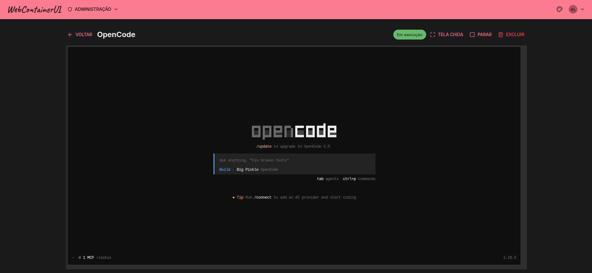

<picture>
  <source media="(prefers-color-scheme: dark)" srcset="docs/logo-dark.png">
  
</picture>

Portal multiusuário para rodar desktops Linux completos dentro do navegador,
usando as imagens [webtop](https://docs.linuxserver.io/images/docker-webtop/) do
LinuxServer.io.

<picture>
  <source srcset="images/agent_page.png">
  
</picture>

## Aviso de segurança, leia antes de implantar

**O processo do portal equivale a root no host.** Ele precisa do socket do Docker
para criar containers, e quem pode criar container pode montar o sistema de
arquivos do host. Um `socket-proxy` restrito **não** mitiga este caso: a
superfície necessária é exatamente a perigosa. Trate o portal como componente de
confiança do plano de controle — imagem mínima, nenhum código de usuário
executado dentro dele.

**O usuário tem root dentro do próprio desktop.** As imagens webtop embutem um
terminal com `sudo` sem senha. A documentação do LinuxServer orienta tratar uma
sessão como um login SSH para uma máquina da sua rede. Não exponha o portal à
internet sem autenticação robusta à frente.

## Instalação

Pré-requisitos: Docker e o plugin Docker Compose v2 no host, e um domínio já
apontando para ele (o Caddy obtém certificado Let's Encrypt automaticamente).

```bash
git clone <url-do-repositorio> webcontainerui
cd webcontainerui
./install.sh
```

O script confere os pré-requisitos, pede o domínio público e as credenciais
do primeiro administrador, gera a chave que cifra as identidades SSH em
repouso, grava tudo em `deploy/.env` e sobe a composição de produção (Caddy +
portal). Rodar `./install.sh` de novo — por exemplo depois de um `git pull`
para atualizar — reaproveita o `deploy/.env` já gravado e só reconstrói e
reinicia os containers.

Prefere configurar à mão, ou automatizar a instalação sem prompts? Veja
`deploy/.env.example` e [`deploy/README.md`](deploy/README.md) — cobre a
ordem de subida manual, as variáveis de ambiente opcionais e o procedimento
de reversão.

## Arquitetura: origem única

Tudo é servido na mesma origem — front-end, API e o encaminhamento das sessões.
Cada instância recebe o caminho `/i/<uuid>/`, e o container é criado com
`SUBFOLDER=/i/<uuid>/` para que suas rotas internas coincidam com esse prefixo.

```
                       BROWSER (dono da instancia)
                             |
                     HTTPS (Let's Encrypt)
                             v
                 +-----------------------+
                 |  Caddy  (so TLS)      |
                 +-----------+-----------+
                             | HTTP + WS
                             v
      +---------------------------------------------------+
      |                   FastAPI                         |
      |  /            front-end (build do React)          |
      |  /api/*       auth, catalogo, instancias, admin    |
      |  /i/{uuid}/*  encaminhamento HTTP + WS            |
      |                   |                               |
      |                   +-- sessao valida?              |
      |                   +-- dono da instancia?          |
      |                   +-- instancia em execucao?      |
      |                   +-- injeta Authorization        |
      +-------------------|-------------------------------+
                          |
                 rede docker wcui_net
            *** containers sem porta publicada ***
                          v
        +-------------+  +-------------+  +-------------+
        |  webtop A   |  |  webtop B   |  |  webtop C   |
        |   :3000     |  |   :3000     |  |   :3000     |
        +-------------+  +-------------+  +-------------+
```

O ponto central: **os containers não publicam porta no host**. Ficam apenas na
rede interna, alcançáveis somente pelo processo do portal. O isolamento entre
usuários é topológico — não existe endereço alternativo para alcançar o desktop de
outra pessoa. A verificação de propriedade no encaminhamento é a segunda camada, e
a credencial aleatória por instância é a terceira.

A origem única também resolve o CSP: o container envia `frame-ancestors 'self'`,
então embutir a sessão em iframe funciona sem relaxar nada.

## Alvo de escala

**10 a 30 sessões simultâneas, um único host Docker.**

O stream de cada sessão atravessa o processo Python. O gargalo prático não é
banda, é bloqueio: uma chamada Docker síncrona travaria o event loop que repassa
os frames de todas as outras sessões. Por isso o portal roda com **um worker** e
usa `aiodocker`, sem nenhuma chamada bloqueante no caminho. Acima de ~50 sessões,
o caminho de crescimento é mover o streaming para um proxy externo com
forward-auth, mantendo a autorização no portal.

## Desenvolvimento

O back-end e o front-end se instalam de forma independente.

```bash
cd backend && python3 -m venv .venv && .venv/bin/pip install -e ".[dev]"
```

```bash
cd frontend && npm ci
```

Rodar a suíte de testes do back-end. O marcador `e2e` está desselecionado por
padrão, então **a suíte não exige Docker**:

```bash
cd backend && .venv/bin/python -m pytest
```

Os testes que exigem Docker real e uma imagem webtop baixada rodam separadamente:

```bash
cd backend && .venv/bin/python -m pytest -m e2e
```

Testes e build do front-end:

```bash
cd frontend && npm test
```

```bash
cd frontend && npm run build
```

Em desenvolvimento o Caddy não é usado: `http://localhost` já é secure context,
que é o que o cliente Selkies exige para WebCodecs funcionar.

## Documentação do projeto

O planejamento vive em `openspec/`. A change `webtop-portal` contém a proposta, as
especificações de comportamento por capability, o design com as decisões de
arquitetura e o plano de tarefas.

```bash
openspec show webtop-portal
```

No startup, o portal cadastra automaticamente uma capa padrão em toda entrada
existente do catálogo, a partir dos logos versionados em `agent-images/covers/`
(ver `agent-images/covers/README.md`). Uma capa enviada pelo administrador
sempre prevalece sobre a padrão.

O administrador também mantém uma biblioteca de documentos `AGENTS.md` (aba
"AGENTS.md" no painel administrativo) e vincula cada imagem do catálogo a um
deles; o texto é injetado como `/config/AGENTS.md` nas instâncias e propagado
às instâncias vivas quando o admin salva alterações.
