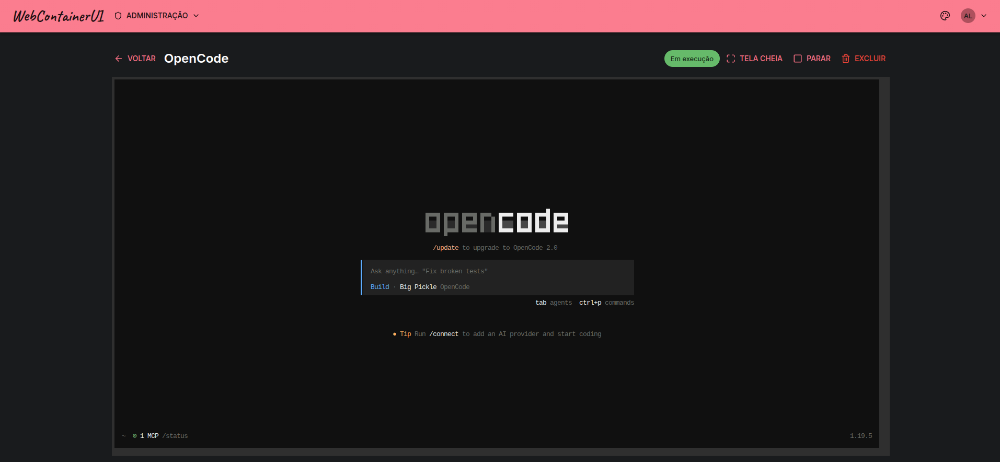

<picture>
  <source media="(prefers-color-scheme: dark)" srcset="docs/logo-dark.png">
  
</picture>

[](LICENSE)


[](https://github.com/alanyoshida/webcontainerui/commits/main)

Portal multiusuário para rodar **desktops Linux completos** e **agentes de
código em CLI** dentro do navegador. Cada pessoa escolhe uma imagem do
catálogo, inicia a própria instância em Docker e trabalha nela pelo navegador.
Os desktops usam as imagens
[webtop](https://docs.linuxserver.io/images/docker-webtop/) do LinuxServer.io;
os agentes (Claude Code, OpenCode, Hermes, Antigravity, oh-my-pi) rodam num
terminal web.

**Site e documentação:**
[português](https://alanyoshida.github.io/webcontainerui/pt-br/) ·
[English](https://alanyoshida.github.io/webcontainerui/)

<picture>
  <source srcset="images/agent_page.png">
  
</picture>

## Aviso de segurança, leia antes de implantar

**O processo do portal equivale a root no host.** Ele precisa do socket do Docker
para criar containers, e quem pode criar container pode montar o sistema de
arquivos do host. Um `socket-proxy` restrito **não** mitiga este caso: a
superfície necessária é exatamente a perigosa. Trate o portal como componente de
confiança do plano de controle — imagem mínima, nenhum código de usuário
executado dentro dele.

**O usuário tem root dentro do próprio desktop.** As imagens webtop embutem um
terminal com `sudo` sem senha. A documentação do LinuxServer orienta tratar uma
sessão como um login SSH para uma máquina da sua rede. Não exponha o portal à
internet sem autenticação robusta à frente.

Detalhes em
[Superfície de confiança](https://alanyoshida.github.io/webcontainerui/pt-br/security/trust-surface/)
e o status de cada achado das auditorias em
[Auditorias](https://alanyoshida.github.io/webcontainerui/pt-br/security/audits/).

## Instalação

Pré-requisitos: Docker e o plugin Docker Compose v2 no host, e um domínio já
apontando para ele (o Caddy obtém certificado Let's Encrypt automaticamente).

```bash
git clone https://github.com/alanyoshida/webcontainerui.git
cd webcontainerui
./install.sh
```

O script confere os pré-requisitos, pede o domínio público e as credenciais do
primeiro administrador, gera os segredos, grava tudo em `deploy/.env` e sobe a
composição de produção (Caddy, portal e PostgreSQL). Rodar `./install.sh` de
novo, por exemplo depois de um `git pull`, reaproveita o `deploy/.env` e só
reconstrói e reinicia os containers.

Guia completo:
[Instalação](https://alanyoshida.github.io/webcontainerui/pt-br/getting-started/installation/)
e, para fazer à mão,
[Subida manual](https://alanyoshida.github.io/webcontainerui/pt-br/operations/manual-deployment/).

## Teste local

Sem domínio, sem TLS e sem Caddy:

```bash
cd deploy
docker compose -f docker-compose.dev.yml up --build
```

A aplicação completa responde em `http://127.0.0.1:8000`, sem precisar de Node
na máquina. Login dev: `admin@local.test` / `senha-admin-dev-123456`. O portal
só escuta em `127.0.0.1`.

## Documentação

| Assunto | Onde |
|---|---|
| O que é, teste local, instalação | [Começar](https://alanyoshida.github.io/webcontainerui/pt-br/getting-started/introduction/) |
| Origem única, plano de dados, banco, escala | [Arquitetura](https://alanyoshida.github.io/webcontainerui/pt-br/architecture/overview/) |
| Superfície de confiança, camadas, auditorias | [Segurança](https://alanyoshida.github.io/webcontainerui/pt-br/security/trust-surface/) |
| Variáveis, backup, reversão | [Operação](https://alanyoshida.github.io/webcontainerui/pt-br/operations/manual-deployment/) |
| Desenvolvimento e testes | [Desenvolvimento](https://alanyoshida.github.io/webcontainerui/pt-br/reference/development/) |

O site é construído a partir de [`site/`](site/); os textos em Markdown estão
em `site/src/content/docs/`. O contrato formal de comportamento de cada
capability está nas specs em [`openspec/specs/`](openspec/specs/), e as
instruções para agentes de código em [`AGENTS.md`](AGENTS.md).

## Licença

Distribuído sob a licença MIT. Veja [LICENSE](LICENSE).
