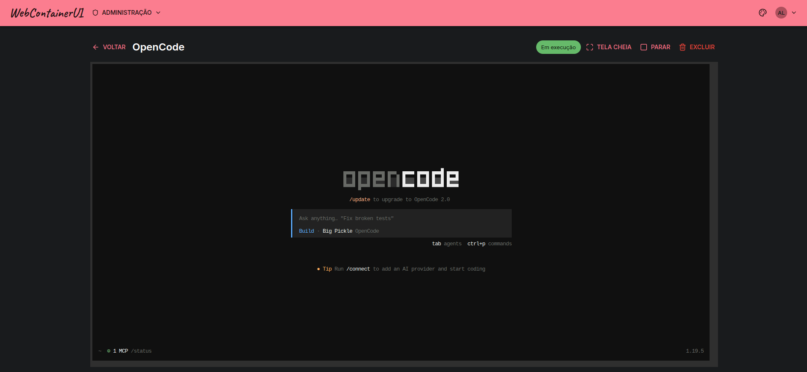

<picture>
  <source media="(prefers-color-scheme: dark)" srcset="docs/logo-dark.png">
  
</picture>

Portal multiusuário para rodar desktops Linux completos dentro do navegador,
usando as imagens [webtop](https://docs.linuxserver.io/images/docker-webtop/) do
LinuxServer.io.

<picture>
  <source srcset="images/agent_page.png">
  
</picture>

## Aviso de segurança, leia antes de implantar

**O processo do portal equivale a root no host.** Ele precisa do socket do Docker
para criar containers, e quem pode criar container pode montar o sistema de
arquivos do host. Um `socket-proxy` restrito **não** mitiga este caso: a
superfície necessária é exatamente a perigosa. Trate o portal como componente de
confiança do plano de controle — imagem mínima, nenhum código de usuário
executado dentro dele.

**O usuário tem root dentro do próprio desktop.** As imagens webtop embutem um
terminal com `sudo` sem senha. A documentação do LinuxServer orienta tratar uma
sessão como um login SSH para uma máquina da sua rede. Não exponha o portal à
internet sem autenticação robusta à frente.

## Instalação

Pré-requisitos: Docker e o plugin Docker Compose v2 no host, e um domínio já
apontando para ele (o Caddy obtém certificado Let's Encrypt automaticamente).

```bash
git clone <url-do-repositorio> webcontainerui
cd webcontainerui
./install.sh
```

O script confere os pré-requisitos, pede o domínio público e as credenciais
do primeiro administrador, gera a chave que cifra as identidades SSH em
repouso, grava tudo em `deploy/.env` e sobe a composição de produção (Caddy +
portal). Rodar `./install.sh` de novo — por exemplo depois de um `git pull`
para atualizar — reaproveita o `deploy/.env` já gravado e só reconstrói e
reinicia os containers.

Prefere configurar à mão, ou automatizar a instalação sem prompts? Veja
`deploy/.env.example` e [`deploy/README.md`](deploy/README.md) — cobre a
ordem de subida manual, as variáveis de ambiente opcionais e o procedimento
de reversão.

## Teste local

Sem domínio, sem TLS e sem Caddy — para experimentar o portal na própria
máquina com um comando:

```bash
cd deploy
docker compose -f docker-compose.dev.yml up --build
```

A imagem é construída a partir do `Dockerfile` da raiz, que já compila o
front-end: a aplicação completa responde em `http://127.0.0.1:8000`, sem
precisar de Node na máquina. Login dev: `admin@local.test` /
`senha-admin-dev-123456`. O portal só escuta em `127.0.0.1` — não fica
exposto à rede.

Para derrubar preservando o banco de dados:

```bash
cd deploy && docker compose -f docker-compose.dev.yml down
```

`http://localhost` já é um secure context, que é o que o cliente Selkies
exige para WebCodecs funcionar — por isso TLS não faz falta aqui.

## Banco de dados

Desenvolvimento e testes locais usam **SQLite** em `/data/webcontainerui.db`
(sem nenhuma dependência extra). Produção usa **PostgreSQL**, provido pela
própria composição (`postgres:17-alpine`, rede interna, sem porta publicada)
e selecionado por `WCUI_DATABASE_URL`. A produção nasce com banco vazio — não
há migração automática do SQLite; backup e reversão estão em
[`deploy/README.md`](deploy/README.md).

O acesso a dados é SQLAlchemy Core, com SQL explícito e parâmetros nomeados,
para rodar igual nos dois motores. A suíte padrão (`pytest`) roda só em
SQLite; a suíte e2e (`pytest -m e2e`) sobe um PostgreSQL efêmero em Docker e
valida bootstrap, login, usuários, ciclo de instância e métricas contra ele.

## Arquitetura: origem única

Tudo é servido na mesma origem — front-end, API e o encaminhamento das sessões.
Cada instância recebe o caminho `/i/<uuid>/`, e o container é criado com
`SUBFOLDER=/i/<uuid>/` para que suas rotas internas coincidam com esse prefixo.

```
                       BROWSER (dono da instancia)
                             |
                     HTTPS (Let's Encrypt)
                             v
                 +-----------------------+
                 |  Caddy                |
                 |  TLS + plano de dados |
                 +-----------+-----------+
                             |
          +------------------+-------------------+
          | /i/{uuid}/*                          | / e /api/*
          | forward_auth + repasse               v
          v                          +---------------------------+
   +------+-----------------+         |          FastAPI          |
   | consulta o portal:     |         |  /        front-end       |
   | sessao? dono? rodando? |<------->|  /api/*   auth, catalogo  |
   | 200 + credencial       |         |  /internal/data-plane/... |
   +------+-----------------+         |  Docker: cria containers  |
          |                           +-------------+-------------+
          |                                         |
          v                                         |
    rede docker wcui_net                            |
    *** containers sem porta publicada ***          |
          |                                         |
          v                                         |
   +-------------+  +-------------+  +-------------+ |
   |  webtop A   |  |  webtop B   |  |  webtop C   |<-+
   |   :3000     |  |   :3000     |  |   :3000     |
   +-------------+  +-------------+  +-------------+
```

O ponto central: **os containers não publicam porta no host**. Ficam apenas na
rede interna. O isolamento entre usuários é topológico — não existe endereço
alternativo para alcançar o desktop de outra pessoa.

O transporte dos frames **não passa pelo processo do portal** em produção: o
Caddy encaminha `/i/{uuid}/*` (HTTP e WS) direto ao container, depois de
consultar o portal por `forward_auth` — sessão válida, dono e instância em
execução. Só a resposta aprovada carrega a credencial interna da instância, que
o Caddy copia para a requisição encaminhada; o cliente nunca a vê. As rotas são
publicadas pelo portal num volume compartilhado (`caddy_routes`). Em
desenvolvimento, sem Caddy, o próprio portal entrega as sessões — o caminho
in-process continua existindo e é o que a suíte de testes usa.

A origem única também resolve o CSP: o container envia `frame-ancestors 'self'`,
então embutir a sessão em iframe funciona sem relaxar nada.

## Alvo de escala

Com o plano de dados no Caddy, o teto deixa de ser o processo do portal: o
limite passa a ser o **host Docker** — CPU e RAM de cada desktop e a banda do
link. O Caddy encaminha milhares de conexões WebSocket sem ser gargalo; numa
máquina dedicada (32 vCPU, 64 GB, 1 Gbps), a ordem de grandeza é **~60–100
sessões ativas**, dominada por CPU/RAM dos containers (cada webtop usa 1–2 GB e
parte de um núcleo em uso real).

O portal continua com **um worker** e usa `aiodocker` sem chamadas bloqueantes:
ele decide autorização e orquestra containers, mas não transporta frames. A
autorização do plano de dados é uma chamada curta por requisição HTTP (o canal
WebSocket abre uma vez), não por frame. Para crescer além de um host, a
estratégia é mais de um host — o banco Postgres (change `postgres-for-production`)
já permite vários portais sobre os mesmos dados. Os números são estimativa de
arquitetura; valide com carga real antes de prometer um teto.

## Desenvolvimento

O back-end e o front-end se instalam de forma independente.

```bash
cd backend && python3 -m venv .venv && .venv/bin/pip install -e ".[dev,postgres]"
```

```bash
cd frontend && npm ci
```

Rodar a suíte de testes do back-end. O marcador `e2e` está desselecionado por
padrão, então **a suíte não exige Docker**:

```bash
cd backend && .venv/bin/python -m pytest
```

Os testes que exigem Docker real e uma imagem webtop baixada rodam separadamente:

```bash
cd backend && .venv/bin/python -m pytest -m e2e
```

Testes e build do front-end:

```bash
cd frontend && npm test
```

```bash
cd frontend && npm run build
```

Em desenvolvimento o Caddy não é usado: `http://localhost` já é secure context,
que é o que o cliente Selkies exige para WebCodecs funcionar.

## Documentação do projeto

O planejamento vive em `openspec/`. A change `webtop-portal` contém a proposta, as
especificações de comportamento por capability, o design com as decisões de
arquitetura e o plano de tarefas.

```bash
openspec show webtop-portal
```

No startup, o portal cadastra automaticamente uma capa padrão em toda entrada
existente do catálogo, a partir dos logos versionados em `agent-images/covers/`
(ver `agent-images/covers/README.md`). Uma capa enviada pelo administrador
sempre prevalece sobre a padrão.

O administrador também mantém uma biblioteca de documentos `AGENTS.md` (aba
"AGENTS.md" no painel administrativo) e vincula cada imagem do catálogo a um
deles; o texto é injetado como `/config/AGENTS.md` nas instâncias e propagado
às instâncias vivas quando o admin salva alterações.
